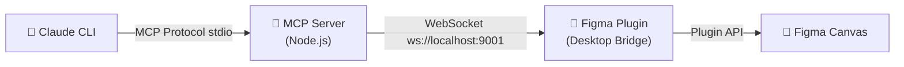

# MCP para Figma

Un puente bidireccional entre clientes MCP (como Claude CLI) y Figma, usando el protocolo MCP (Model Context Protocol).

Dado que la REST API de Figma no permite crear ni modificar nodos directamente (es de solo lectura), este proyecto utiliza una arquitectura de puente basada en WebSocket:

1. **MCP Server**: Se ejecuta localmente (consumido por tu IDE a través de stdio) y expone más de 30 tools para diseñar.
2. **Figma Plugin (Desktop Bridge)**: Se ejecuta dentro de la app de escritorio de Figma y recibe los comandos vía WebSocket para ejecutarlos usando la Plugin API de Figma.

## Arquitectura



## Setup Inicial

### 1. Compilar los proyectos

Si aún no lo has hecho, instala las dependencias y compila ambos proyectos:

```bash
# Compilar el servidor MCP
cd figma-mcp-server
npm install
npm run build

# Compilar el plugin de Figma
cd ../figma-bridge-plugin
npm install
npm run build
```

### 2. Configurar el MCP Server en Claude CLI

Agrega el servidor a la configuración MCP de Claude CLI con un bloque como este (ajusta la ruta absoluta a tu workspace):

```json
{
    "mcpServers": {
        "figma-mcp": {
            "command": "node",
            "args": ["/ruta/absoluta/figma-mcp-server/dist/index.js"],
            "env": {
                "FIGMA_WS_PORT": "9001"
            }
        }
    }
}
```

Luego recarga Claude CLI para que detecte el servidor MCP.

### 3. Instalar y ejecutar el Plugin en Figma

1. Abre la **app de escritorio de Figma** (no funciona en la versión web).
2. Ve al menú de Figma > **Plugins** > **Development** > **Import plugin from manifest...**
3. Selecciona el archivo `manifest.json` ubicado en la carpeta `figma-bridge-plugin`.
4. Ejecuta el plugin "Figma MCP Bridge".
5. Verás una ventana pequeña indicando "Connected" (si Claude CLI está corriendo el servidor MCP) o "Connecting..." (esperando a que se conecte el cliente MCP).

## Uso

Una vez que el plugin indique "Connected", puedes pedirle a Claude CLI (o cualquier agente compatible) que diseñe en Figma.

Ejemplos de prompts que puedes usar:
- "Crea un rectángulo azul de 200x200 en Figma"
- "Agrega un texto que diga 'Hola Mundo' con fuente Inter de 32px"
- "Crea un frame llamado 'Card', ponle auto-layout vertical con 16px de padding, y agrega un título y un rectángulo gris dentro."
- "¿Qué elementos tengo seleccionados actualmente?"

## Tools Disponibles

### Lectura
- `get_selection`
- `get_page_nodes`
- `get_node_properties`
- `get_local_styles`

### Creación
- `create_rectangle`, `create_ellipse`, `create_text`, `create_frame`
- `create_component`, `create_instance`
- `create_line`, `create_polygon`, `create_star`

### Modificación
- `move_node`, `resize_node`, `rename_node`
- `set_fills`, `set_strokes`, `set_effects`, `set_corner_radius`, `set_opacity`
- `set_text_content`, `set_text_style`
- `delete_node`, `duplicate_node`

### Layout y Estilos
- `set_auto_layout`, `remove_auto_layout`, `set_constraints`, `set_layout_sizing`
- `group_nodes`, `ungroup_nodes`
- `set_solid_fill`, `set_visibility`, `set_rotation`, `set_blend_mode`

### Exportación
- `export_node` (PNG, SVG, JPG, PDF)
- `get_image` (Screenshot del nodo)
